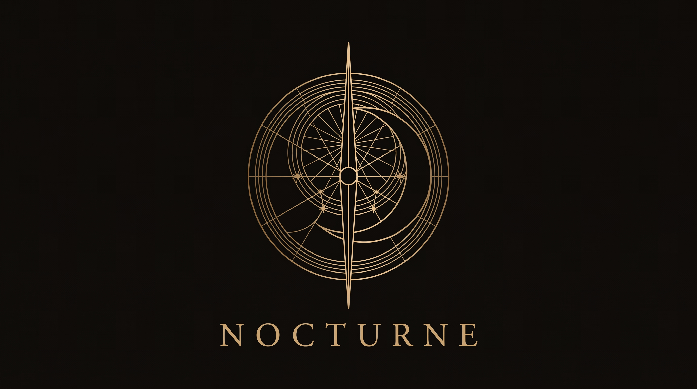

<div align="center">
  
</div>

# Nocturne

**Banani Road 11, Level 14 Penthouse Rooftop Dining Sanctuary in Dhaka**

Nocturne is a full-stack fine-dining reservation, spatial seat-locking, seasonal menu customization, and culinary concierge platform built for an open-fire oak-hearth rooftop restaurant overlooking Banani Lake, Dhaka. Every dish is 100% Zabiha Halal with zero-proof botanical mixology and dedicated allergen station separation.

---

## Key Capabilities

### 1. Spatial Floorplan & Two-Phase Atomic Seat Locking
- **Architectural 2D Floorplan Studio:** Interactive SVG layout (`1000 x 650` coordinate grid) spanning 18 seeded tables across three distinct dining zones:
  - **The Skyline Rooftop** (`T-01` through `T-06`, 48–53 dB quiet window-side 2-top tables)
  - **The Chef's Glass Kitchen** (`T-07` through `T-12`, 55–66 dB white-oak hearth & center 4-top dining)
  - **The Velvet Lounge** (`B-01` through `B-06`, 44–47 dB secluded smoked-glass 6-top VIP booths)
- **Perspective Previews & Acoustic Metering:** Selecting any table displays its real first-person sightline photography, decibel level, wing ambiance, and capacity range.
- **Distributed Redis 10-Minute Hold:** Clicking an open table triggers an atomic Redis lock (`SET key val NX EX 600`) scoped to date, evening slot (`19:00`, `20:30`, `22:00`), and guest session. Switching tables automatically releases the guest's prior lock, while PostgreSQL double-booking guards enforce exclusivity upon confirmation.

### 2. Seasonal Tasting Wheel & Sequence Customization
- **Curved Horizon Dish Wheel:** Browse all 12 curated wood-fired courses, small plates, artisanal pasta, desserts, and zero-proof botanical mocktails.
- **Real-Time Macro & Allergen Telemetry:** Filter by **Dairy-Free**, **Nut-Free**, and **Gluten-Free** kitchen lines; adjust portion sizes, spice intensity, and curated accompaniments with live BDT pricing, kcal, and protein calculations.
- **Persistent Pre-Order Tray:** Selected courses bind directly to the guest's held table for priority firing upon arrival.

### 3. Early Settlement, Digital Pass & Lifecycle Refunds
- **Flexible Payment Options:** Confirm a reservation to settle **At Venue**, or pre-pay the table deposit / full pre-order total via **bKash Tokenized Checkout** or **Card Checkout (Stripe)**. When gateway credentials are omitted, Nocturne operates cleanly with an integrated **Test Checkout** flow.
- **Host Stand Digital Pass (`/booking/[referenceCode]`):** Lookup reservations by booking reference (`NOC-2026-...`) or mobile number (`+880...`). Includes live hold/settlement history and idempotent host stand check-in.
- **Cancellation & No-Show Refund Policy:**
  - **Free Cancellation Window (more than 4 hours before seating):** Releases the table and triggers a 100% refund of any pre-paid deposit or pre-order.
  - **Last-Minute Cancellation (under 4 hours) & No-Show (after 15-minute grace period):** Retains the `৳ 1,000` penthouse table reservation fee while refunding any pre-order culinary balance above the deposit.

### 4. Grounded Culinary Concierge Drawer
- **Hybrid Retrieval (SQL + `pgvector` + `pg_trgm`):** Queries live table availability and Redis lock state alongside vector + lexical search over kitchen allergen matrices, seating policy SOPs, sommelier pairings, and verified diner reviews.
- **Free Llama Provider Support with Grounded Fallback:** Streams via Groq (`GROQ_API_KEY`), free OpenAI-compatible Llama endpoints such as OpenRouter (`LLAMA_API_KEY` + `LLAMA_BASE_URL`), or local Ollama (`OLLAMA_BASE_URL`), and automatically falls back to Nocturne's deterministic SQL + `pgvector` responder with zero external API keys required.
- **One-Click Seating & Pairing Action:** Returns structured table and dish recommendations that hold the recommended seat and populate the guest's tray in a single click.

---

## Architecture Overview

| Layer | Implementation |
|---|---|
| Frontend | Next.js 15 App Router, React 19, TypeScript, Tailwind CSS, TanStack Query, GSAP, Framer Motion, Lenis |
| Backend | FastAPI, Pydantic Settings, SQLAlchemy 2 Async (`asyncpg`), Alembic migrations |
| Primary Database | PostgreSQL 16 with `pgvector` (384-d vector embeddings) and `pg_trgm` |
| Lock & Ephemeral Cache | Redis (`redis.asyncio`) with atomic `SET NX EX` seat holds |
| Concierge Streaming | Server-Sent Events (SSE) with LangChain ChatGroq / OpenAI-compatible Llama client + grounded fallback |

---

## Repository Structure

```text
Nocturne/
├── .env.example                 Environment template for backend, database, Redis, Llama, and payments
├── SPECIFICATION.md             Architectural and domain specification
├── docker-compose.yml           Local PostgreSQL (pgvector) + Redis stack
├── backend/
│   ├── Dockerfile               Production image running migrations, idempotent seeding, and Uvicorn
│   ├── requirements.txt         Python dependencies
│   ├── alembic/                 Database schema migrations (initial tables, early payment, refund ledger)
│   ├── app/
│   │   ├── api/v1/              REST & SSE endpoints (health, zones, tables, menu, reservations, payments, concierge)
│   │   ├── core/                Configuration and normalized cloud DATABASE_URL validator
│   │   ├── db/                  Async SQLAlchemy session, Redis client, and seeded restaurant catalog
│   │   ├── models/              ORM models (zones, tables, menu_items, reservations, payment_transactions, knowledge chunks)
│   │   ├── schemas/             Pydantic request and response contracts
│   │   └── services/            Two-phase seat lock, cancellation/no-show refunds, bKash/Stripe/Test payments, hybrid RAG
│   ├── knowledge_docs/          Grounded kitchen allergen matrix, rooftop SOPs, sommelier pairings, and reviews
│   ├── scripts/seed_nocturne.py Idempotent relational and pgvector database seeder
│   └── tests/                   FastAPI pytest suite covering concurrency, lifecycle edge cases, payments, and RAG
└── frontend/
    ├── public/                  Nocturne favicon suite, manifest, local studio dish photography, and zone video loops
    └── src/
        ├── app/                 Pages: Editorial home (/), 2D Floorplan (/reserve), Tasting Menu (/menu), Booking Pass (/booking/[code])
        ├── components/          UI sections, curved dish wheel, SVG floorplan, concierge drawer, pre-order tray
        ├── context/             Shared guest session, dining date/slot/party, held table, and tray state
        ├── lib/                 Typed API client, dish image framing helpers, and resilient fallback catalog
        └── types/               Shared TypeScript domain contracts
```

---

## Local Development

1. **Configure Environment:** Copy `.env.example` to `.env` in the repository root and update database, Redis, or free Llama credentials as needed.
2. **Start Infrastructure (PostgreSQL with `pgvector` + Redis):**
   ```bash
   docker compose up -d
   ```
3. **Run Backend:**
   ```bash
   cd backend
   python -m venv .venv
   # Activate virtual environment, then install dependencies:
   pip install -r requirements.txt
   alembic upgrade head
   python scripts/seed_nocturne.py
   uvicorn app.main:app --reload --port 8000
   ```
4. **Run Frontend:**
   ```bash
   cd frontend
   npm install
   npm run dev
   ```
   Open `http://localhost:3300`.

5. **Run Verification Tests:**
   ```bash
   cd backend
   pytest -v

   cd ../frontend
   npm run typecheck
   npm run lint
   ```

---

## Cloud Deployment

- **Database & Cache:** Managed PostgreSQL with `pgvector` enabled (such as Neon) and Redis (such as Railway Redis).
- **Backend Service (Railway):** Deploy from the `backend` root directory using `backend/Dockerfile`, listening on port `8000`. Configure `DATABASE_URL`, `REDIS_URL`, `CORS_ORIGINS`, `FRONTEND_URL`, `GROQ_API_KEY` (or `LLAMA_API_KEY` + `LLAMA_BASE_URL`), `PAYMENT_ALLOW_DEMO_SIMULATION=true`, and optional bKash / Stripe sandbox keys.
- **Frontend Service (Vercel):** Deploy from the `frontend` root directory with `NEXT_PUBLIC_API_URL` pointing to your public Railway backend domain.
